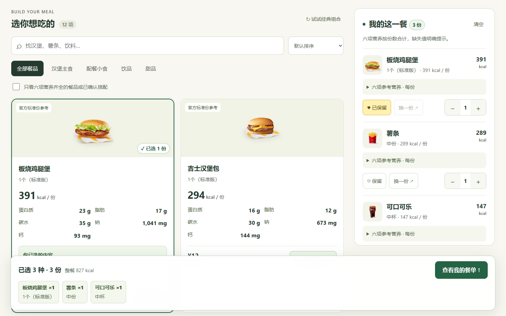
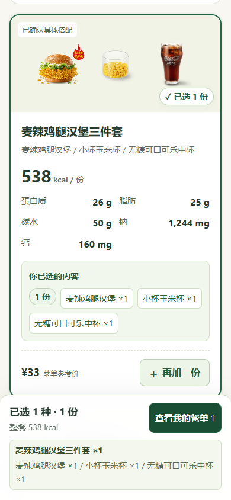

# 麦麦知量

点餐前看清每项营养，换配时立即比较这一餐的变化。面向想吃得明白、又不想反复查营养表的普通消费者：午餐选套餐时，能直接知道把薯条换玉米、可乐换无糖后，这一餐的热量和其他营养改变多少，不必手动查表、记规格和加总。

基于麦当劳中国 MCP，支持选择真实门店、展开套餐组成、替换官方允许的配餐、核验报价，以及保存和重新核验恢复具体搭配。本项目为独立开发的非官方参赛作品；营养是标准份参考值，不构成医疗或营养建议。





## 快速开始

需要 Node.js 22 或更高版本，无外部运行依赖，无需安装 npm 包。

```sh
git clone https://github.com/Ridge-Lab/maimai-nutrition.git
cd maimai-nutrition
npm start
# 或 node server.mjs
```

打开 **http://127.0.0.1:4318**：

1. 先用 12 个参考单品和 43 款公开参考套餐体验营养汇总、套餐换配和常用组合，无需 Token。套餐卡片先展示默认搭配的营养预览，展开后确认具体所选内容。
2. 使用真实门店时，点击“连接麦当劳”，在本机表单粘贴本人已激活的 MCP Token，点击“连接并验证”。Token 不要发到聊天或提交到仓库。
3. 点击“选择门店”，输入城市与商圈，选择查询结果中的餐厅。默认上海示例不代表用户所在地。
4. 选店后默认进入“套餐”分类，读取该店实际可选项；未选店时可先体验明确标注的示例套餐。查看各轮选项与六项营养；更换配餐后，确认具体组成和差值，再加入餐单。多份轮次可分别增减候选餐品的数量。
5. 调整份数，查看整餐营养，主动核验官方报价；喜欢的餐单可“保存为常用组合”。从“常用组合”或刷新后的草稿提示重新核验恢复。

Token 仅存于本机服务进程内存，停止服务后清除；不写入浏览器存储或文件。静态网站可体验参考单品、套餐换配与保存恢复，不接收 Token，也不连接个人会员账号。线上示例不代表实时门店菜单或官方报价。详细步骤见 [TOKEN_SETUP.md](TOKEN_SETUP.md)。

## 可以做什么

- 逐项、套餐组成与整餐展示热量、蛋白质、脂肪、碳水化合物、钠、钙；份数改变后同步计算。缺项时保留已知营养下限，并列出缺数据的具体成分和指标；未知值不填零，真实零值保留。
- 套餐先预览默认搭配，展开后按轮次选择；支持每轮单选和多份选配，份数限制、当前选择与还需选择的数量清楚显示。玩具等非食品不计入营养。
- 按当前实际份数比较换配前后六项营养与金额差值。箭头展示升降；颜色按用户选择的比较目标解释，脂肪、碳水、钙不预设越低越好。
- 设置本餐热量、金额及可选营养约束，保留喜欢的餐品；金额筛选使用参考价，最终金额需官方核价。
- 餐品照片帮助识别，已选卡片、套餐轮次和底部清单持续显示具体搭配与份数。
- 常用组合和草稿在当前浏览器保存门店、餐品编码、轮次选择、份数与保留状态，包括同一轮中不同餐品的各自份数。真实门店配方恢复时重查菜单、营养与详情；参考套餐按随应用提供的快照重新计算。任一原选项失效则整体阻止恢复，保留当前餐单。旧报价不保存、不复用。
- 显示逐项来源和数据覆盖；已确认的具体搭配独立计入，不把某个配方的营养套给整个套餐 SKU。

## 数据、照片与价格

参考目录保留 12 个明确规格的单品；其 72 个六项营养值已逐项核对 8 个官网营养页，并与 MCP 同名同规格记录交叉验证。**2026-10-15** 重新查询的 160 条官方 MCP 记录，六项字段与应用快照逐项一致。官网营养声明版本为 **2025 年 4 月**，查询日期不等于营养测定或配方更新时间。数据对应标准份和杯型，并非每 100 克或实际摄入测量。核验表、来源优先规则及官方页面之间的已知差异见 [NUTRITION_SOURCES.md](NUTRITION_SOURCES.md)。

另提供 **2026-10-15** 查询的 43 款公开参考套餐快照，组成、选配轮次和基础营养来自官方 MCP，见 [dist/sample-menu.mjs](dist/sample-menu.mjs)。本次按官网补入已验证的盒装纯牛奶与椒盐风味那么大鸡排后，**25 款默认搭配六项营养完整，18 款仍有缺项**。此前 23 款完整／20 款缺项是补充前的历史状态。换配后按实际选择重新计算，不能把默认搭配的完整程度套给其他配方。快照不代表当前门店的在售状态、可选范围或售价。

官网补充只用于证据充分的对应产品：盒装牛奶限定已核实的编码，椒盐鸡排必须完整口味与份型对应。仍有 **32 种可选餐品**未取得同规格的官方六项营养，包括新品、蘸酱、未明确杯型的饮品及有名称歧义的鱼堡等；它们不等同于 32 款默认套餐。逐项原因、官网链接、补充值和查询日期见 [NUTRITION_GAPS.md](NUTRITION_GAPS.md)。MCP 有有效 kcal 时保留官方原值；官网仅提供 kJ 的补充才按 `Math.round(kJ / 4.184)` 换算。缺项不记零，已知下限不代表整餐总量。

12 个参考单品使用 8 张官方原始产品照片；公开参考套餐使用快照中保留的官方餐品图片，实时门店菜单优先使用 MCP 返回的餐品照片。套餐换配后，组成照片随实际所选汉堡、配餐和饮料更新。不同份量可能共用产品照片，实际规格和组成以文字清单为准；图片失败时回退示意插图。图片来源与权利说明见 [PHOTO_SOURCES.md](PHOTO_SOURCES.md)。

参考目录中的价格全部是交互演示价。真实门店目录价同样仅供参考；`calculate-price` 的官方报价只适用于当次门店、数量和搭配，餐单改变或恢复后须重新核价。本工具不创建订单、不付款、不收款。

## 验证与能力边界

**2026-10-15 已完成真实官方 MCP 的浏览器流程验收**：从选门店、套餐换配、查看组件和整餐营养，到官方核价、保存组合、常用组合恢复、刷新后恢复草稿，9 个阶段通过，共记录 21 次本机 API 请求。授权失败分支使用模拟响应单独回归，不将模拟结果当成真实官方错误。详见 [VALIDATION.md](VALIDATION.md) 和 [MCP_INTEGRATION.md](MCP_INTEGRATION.md)。

示例门店 `1450713` 的麦辣鸡腿汉堡三件套，将中薯换为小杯玉米、中杯可乐换为中杯无糖可乐：每份参考热量 **921 → 538 kcal**。两份合计 **1076 kcal、蛋白质 52 g、脂肪 50 g、碳水 100 g、钠 2488 mg、钙 320 mg**；2026-10-15 21:19:32 官方报价为 **66 元**。这是一笔已验证的历史报价，不承诺当前售价。份数、保留状态及具体轮次选择经保存和刷新恢复后保持一致，失效选项会阻断恢复。

- 自动检查覆盖营养计算、缺失传播、换配差值、菜单匹配、保存恢复、存储不可用、认证失败和异步旧响应防护；最新检查范围与结果见 [VALIDATION.md](VALIDATION.md)。
- 已在独立 Chromium 中完成桌面及手机模拟尺寸的渲染与交互检查，套餐组成照片在 1440、1001、390、320 px 宽度下随所选内容正确更新；不等同于实体 iOS、Android 设备验收。
- 当前支持套餐每轮单选和多份轮次，并按各候选项的实际份数计算营养、保存配方和生成核价参数。少酱、去冰等特制保持官方默认，不虚构营养扣减。
- 2026-10-15 21:36 曾对示例店当时返回的 45 个套餐／组合候选逐一读取详情：38 个符合每轮必选一份的结构，另外 7 个包含多份轮次，当时尚未支持；本次已补上多份轮次支持。该历史盘点不代表全店全时段或 38 个营养均齐全。开心乐园餐的玩具保留选项与核价，明确标为非食品，不计营养。
- 上述历史验收中，示例真实菜单过滤周边后有 102 个原始餐品，初始仅 17 个六项营养齐全。当前仍按明确规格匹配并按需展开套餐；缺数据时点名缺项、显示已知部分，不宣称全菜单覆盖。公开参考套餐的覆盖统计独立于实时门店菜单。

```sh
npm test
```

## 参赛发布状态

截至 2026-10-15，必需文件已具备：[官方原文参赛声明](CONTEST_DECLARATION.md)、[MCP 接入说明](MCP_INTEGRATION.md)及[环境变量配置示例](mcp-config.example.json)。声明与官方原文一致。

源码仓库：[Ridge-Lab/maimai-nutrition](https://github.com/Ridge-Lab/maimai-nutrition)。当前[网站预览](https://ridge-maimai-nutrition-20261015.warm-snipe-0988.chatgpt.site/)为所有者私有访问。正式参赛须按[官方规则](https://github.com/M-China/mcd-developer-innovation-challenge/blob/main/activityGuidelines.md)提交报名，以官方 Issue 成功回执确认报名状态；源码上传或网站部署本身不代表报名成功。本项目未使用 WorkBuddy，不申报其开发专项奖励。

43 款参考套餐的保存与严格恢复已验收。桌面 1440 与手机 390／320 px 的换配、营养、已选清单及确认按钮已复验，记录见 [VALIDATION.md](VALIDATION.md)。
